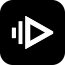

<div align="center">



# FunkyPlayer2000 for Android

**The early-2000s music player, now in your pocket.** Windows XP "Luna" look, LED spectrum analyzer, background playback.

</div>

> **Status: stage 1 of 4.** Plays the music on your phone. YouTube Music, synced lyrics, library folder, playlists and history are coming in the next stages (see the [roadmap](#roadmap)). The desktop version lives in its own repository.

## Features (stage 1)

- Windows XP look and feel: blue title bar, bevelled buttons, zebra-striped lists.
- Plays the music on your device (mp3, flac, ogg, opus, wav, m4a, aac and anything else Android can decode).
- **Background playback** with a media notification, lock-screen controls and headset buttons.
- **Real-time LED spectrum analyzer** (tap it to switch to an oscilloscope). It reads the audio being played, so no microphone permission is needed.
- Library tab: your music grouped by artist and album, with search. Tap a track to play its album from there, `+` to queue it.
- Queue with shuffle, repeat (off / all / one), seek bar and cover art.
- "Add files…" to play any audio file from anywhere via the system file picker.

```
app/src/main/java/com/funkyplayer2000/
  MainActivity.kt        entry point (edge-to-edge window)
  PlaybackService.kt     ExoPlayer in a media session service + the audio tap
  PlayerViewModel.kt     connects the screen to the player and holds the queue state
  AudioTap.kt            last played samples + FFT for the visualizer
  MusicLibrary.kt        reads the device music (MediaStore) and file tags
  CoverLoader.kt         cover art (thumbnail or embedded picture)
  ui/Xp.kt               Windows XP widgets (buttons, tabs, seek bar, title bar)
  ui/Visualizer.kt       LED spectrum analyzer / oscilloscope
  ui/PlayerScreen.kt     the whole screen: now playing, transport, queue, library
.github/workflows/build-apk.yml   builds the APK on GitHub
```

## Disclaimer

A personal, non-commercial project, **not affiliated with** Microsoft or any service mentioned here. The Windows XP look is an homage.

## License

[MIT](LICENSE) (stage 1)
